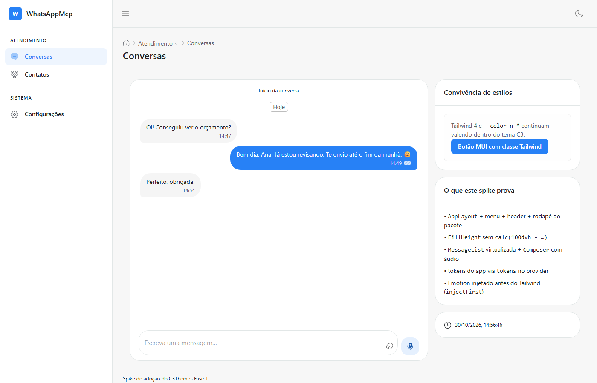

# Spike de convivência — C3Theme rodando dentro do WhatsAppMcp (Fase 1)

> **O que foi feito:** o `@c3theme/ui` + `@c3theme/chat` do `origin/main` do C3Theme (`8744b8f`, 30/10/2026) foram instalados no app e montados numa rota de desenvolvimento (`/?c3spike`) para responder, com medição, as quatro perguntas que bloqueavam a adoção: preflight × `CssBaseline`, dois dark modes, z-index/portais e custo de bundle. O app real continua intocado quando o parâmetro não está na URL.
>
> **Resultado:** funciona. Shell, chat virtualizado e composer do pacote renderizam ao lado do Tailwind, com os tokens do app aplicados ao tema, sem erro de console, com o build, o lint e as suítes de teste verdes (após três correções de integração descritas abaixo).



---

## 1. O que o spike monta

| Peça                   | Do pacote                                                                                                                       | Prova                                                                                                                             |
| ---------------------- | ------------------------------------------------------------------------------------------------------------------------------- | --------------------------------------------------------------------------------------------------------------------------------- |
| Shell                  | `AppLayout` (menu lateral, header, breadcrumb automático, rodapé)                                                               | menu vem de uma constante; o app real vai alimentar de `route.ts`/`navItems.ts`                                                   |
| Página de altura cheia | `FillHeight`                                                                                                                    | fim do `calc(100dvh - 220px)` da vitrine                                                                                          |
| Tema                   | `C3ThemeProvider` com `brand: 'green'`, `locale: 'pt-BR'`, `storageKey` próprio                                                 | —                                                                                                                                 |
| **Ponte de tokens**    | `tokens={{ light: {...}, dark: {...} }}`                                                                                        | cores do `agent.css` (`#f7f7f7`, `#ffffff`, `#1c2024`, `#60646c`, `#e2e7e7`, `#2781f6`) entram no tema C3 sem reescrever a paleta |
| Chat                   | `MessageList` (virtualizada, separador de dia), `MessageBubble`, `Composer` (anexo, áudio, Enter envia)                         | tipos do app ainda não convertidos: o spike usa 3 mensagens locais                                                                |
| Aviso                  | `notify` + `<Notifier />`                                                                                                       | —                                                                                                                                 |
| Convivência            | um cartão Tailwind (`border-n-weak`, `bg-n-surface-1`, `text-n-slate-11`) e um `Button` MUI com `className="mt-2 rounded-full"` | Tailwind e MUI na mesma árvore                                                                                                    |

Arquivos: [`src/agent/c3/spike.tsx`](../../src/agent/c3/spike.tsx), [`src/agent/Entry.tsx`](../../src/agent/Entry.tsx), [`vite.config.ts`](../../vite.config.ts), [`scripts/c3-spike-check.mjs`](../../scripts/c3-spike-check.mjs) (verificação headless).

## 2. Medições

| Medida                                  | Sem o spike |                    Com o spike |                               Δ |
| --------------------------------------- | ----------: | -----------------------------: | ------------------------------: |
| `main-*.js`                             |   762.643 B |     764.558 B (gzip 222,13 kB) | **+1.915 B** (o chunk é `lazy`) |
| `spike-*.js` (só carrega em `?c3spike`) |           — | 567.647 B (**gzip 170,01 kB**) |   custo do C3 quando a tela usa |
| `main-*.css` (Tailwind)                 |    54.288 B |       54.288 B (gzip 10,86 kB) |                           **0** |

Leitura: MUI + Emotion + `@c3theme/ui` + `@c3theme/chat` + `iconsax` + `react-router` + `react-intl` custam **~170 kB gzip**, pagos só na tela que carregar o pacote. O app principal não engorda (o spike entra por `React.lazy`). O CSS do Tailwind não muda — o preflight não conflitou com o que o spike usou.

> Números de referência do app antes da branch: 584,5 kB JS. O `main` atual (762,6 kB) já cresceu pelas 7 entregas da branch `feat/agent-thoughts`, não pelo C3 — por isso a comparação válida é a coluna "Δ".

## 3. Testes e verificação

| Verificação                                                  | Resultado                                                                                        |
| ------------------------------------------------------------ | ------------------------------------------------------------------------------------------------ |
| `npx tsc --noEmit`                                           | verde                                                                                            |
| `npm run lint` (ESLint + arquitetura + limite de 300 linhas) | verde                                                                                            |
| `npm test` (node)                                            | 6/6                                                                                              |
| `npm run test:ui` (vitest + cobertura)                       | verde, limiares 80/80/80/70 mantidos                                                             |
| `node scripts/c3-spike-check.mjs …?c3spike`                  | sem `console:error`/`pageerror`; `MuiAppBar`, `textarea` e balões no DOM; `data-c3-mode="light"` |
| App real (`/`, sem parâmetro)                                | renderiza a tela de login normalmente; `data-theme="light"` do app intacto                       |

## 4. As três correções que a integração exigiu (e uma quarta pendente)

1. **Dois Reacts.** Os pacotes do C3Theme, instalados por link (`file:`/workspace), resolvem o React do próprio monorepo. Sem correção o app quebra com `Cannot read properties of null (reading 'useMemo')`. Correção no [`vite.config.ts`](../../vite.config.ts):
   ```ts
   resolve: {
     dedupe: [
       'react',
       'react-dom',
       'react-router',
       'react-intl',
       '@mui/material',
       '@emotion/react',
       '@emotion/styled',
     ];
   }
   ```
   `react-router` e `react-intl` precisam entrar junto: são contextos (`<Router>`, `<IntlProvider>`) e a falha seguinte foi `useLocation() may be used only in the context of a <Router>`.
2. **Emotion antes do Tailwind.** O spike envolve a árvore em `StyledEngineProvider injectFirst`; validado. **O `C3ThemeProvider` do pacote ainda não faz isso** — pedir que ele embuta o `injectFirst`, senão cada app tem de lembrar (é a mitigação do risco R1 da [análise](00-analise-e-plano.md)).
3. **Cobertura de teste.** O spike é dev-only e não tem teste; entrou em `coverage.exclude` do [`vitest.config.ts`](../../vitest.config.ts) junto de `main.tsx`/`Entry.tsx` (sem afrouxar limiares).
4. **Dois donos do dark mode (pendente).** O app escreve `data-theme` ([`theme.ts`](../../src/agent/theme/theme.ts)); o C3 escreve `data-c3-mode`. Os dois convivem no spike, mas a fundação precisa de **um** dono (Fase 2): um hook que chame `useColorScheme` do MUI e escreva `data-theme`, ou usar `useColorMode` do pacote — que **não está exportado** hoje (assim como `Z_INDEX`); é um pedido pequeno ao C3Theme.

## 5. Bloqueio real da adoção: o app usa npm e o pacote é publicado por subpasta

O C3Theme instala por git **com subpasta** (`github:cecon/C3Theme#<sha>&path:packages/ui`) — recurso do **pnpm**. O WhatsAppMcp usa **npm**, que não instala subpasta de monorepo; `npm i github:…` tentaria o `package.json` da raiz do monorepo. O spike contornou com `file:` para um worktree compilado e `--no-save`.

| Opção                                  | Como                                                                                                                                                                                     | Custo                               | Risco                                  |
| -------------------------------------- | ---------------------------------------------------------------------------------------------------------------------------------------------------------------------------------------- | ----------------------------------- | -------------------------------------- |
| **A. Migrar para pnpm** (recomendada)  | remover `package-lock.json`, gerar `pnpm-lock.yaml`, `packageManager: pnpm@10`, CI/release com `pnpm/action-setup`; `pnpm add "@c3theme/ui@github:cecon/C3Theme#<sha>&path:packages/ui"` | ~0,5 dia + validação do build Tauri | médio (um gerenciador novo no release) |
| B. Tarballs por release no C3Theme     | workflow no C3Theme publica `c3theme-ui-<ver>.tgz`/`c3theme-chat-<ver>.tgz`; app depende da URL do GitHub Release                                                                        | ~1 dia no C3Theme                   | baixo; npm continua                    |
| C. Checkout do C3Theme no CI + `file:` | duas checkouts no workflow; caminho configurável por env                                                                                                                                 | ~1 dia                              | baixo, porém artesanal                 |
| D. Registry privado (GitHub Packages)  | publicar com escopo `@c3theme`                                                                                                                                                           | ~1 dia + infra                      | baixo, porém mais peças                |

**Recomendação:** **A** (alinha com o C3Theme e o nati-next, que já usam pnpm) e manter **B** de reserva se o release do app não puder mudar de gerenciador agora.

**Decisão executada (30/10):** opção **A**. A migração está no commit `chore(deps): migrate to pnpm…` e o resultado da fundação, com evidências, em [05-fundacao.md](05-fundacao.md).

## 6. Como reproduzir

```powershell
# 1. C3Theme no commit da entrega, fora do working tree WIP
git -C D:\projetos\C3Theme worktree add D:\projetos\C3Theme-main --detach 8744b8fee317fc07e2a5131f00a206f8202a2f30
cd D:\projetos\C3Theme-main
pnpm install --filter "@c3theme/ui" --filter "@c3theme/chat"   # o prepare compila os dois

# 2. App: pacotes por link e peers, sem tocar em package.json/lock (spike)
cd D:\projetos\WhatsAppMcp
npm install --no-save --ignore-scripts `
  "file:D:/projetos/C3Theme-main/packages/ui" "file:D:/projetos/C3Theme-main/packages/chat" `
  "@mui/material@^9.4.0" "@emotion/react" "@emotion/styled" "@emotion/cache" `
  "react-intl@^12.0.0" "react-router@^8.0.0" "iconsax-reactjs@^0.0.8" `
  "@tanstack/react-table@^8.21.3" "@tanstack/react-virtual@^3.13.0" "stylis" "stylis-plugin-rtl"

# 3. Rodar: dev do app em http://127.0.0.1:1420/?c3spike (ou build + preview)
npm run build
npx vite preview --port 4173 --strictPort
node scripts/c3-spike-check.mjs "http://localhost:4173/?c3spike" "test-results/c3-spike.png"
```

## 7. Próximos passos (Fase 2 — fundação)

1. **Decidir gerenciador de pacotes** (§5) e fixar o SHA do C3Theme no `package.json`/lock.
2. **Provider único** (`src/agent/c3/C3Provider.tsx`): `C3ThemeProvider` + `tokens` derivados do `agent.css` + `StyledEngineProvider injectFirst` + `Notifier`; montado dentro do `AgentApp`, não só no spike.
3. **Dark mode com um dono só**: sincronizar `useColorScheme` ⇄ `data-theme`; pedir `useColorMode`/`Z_INDEX` públicos ao C3Theme.
4. **Router**: adicionar `react-router` 8 com `basename: '/app'`, mapear o `route.ts` e trocar `Workspace`/`Sidebar` pelo `AppLayout` (menu de `navItems.ts`, header com busca/notificações/usuário).
5. **Stubs de teste**: `matchMedia` e `ResizeObserver` no `tests/ui/setup.ts` **antes** da primeira tela MUI.
6. **Lote piloto**: Configurações → Etiquetas com `DataTable` + campos do pacote, medindo a régua de conversão.
7. **Chat**: implementar `ChatTransport` sobre a API atual (`loadMessages`/`send`/`subscribe`) e trocar a lista/bolha/composer do app pelo `@c3theme/chat`, mantendo formatação WhatsApp via `renderText`.
