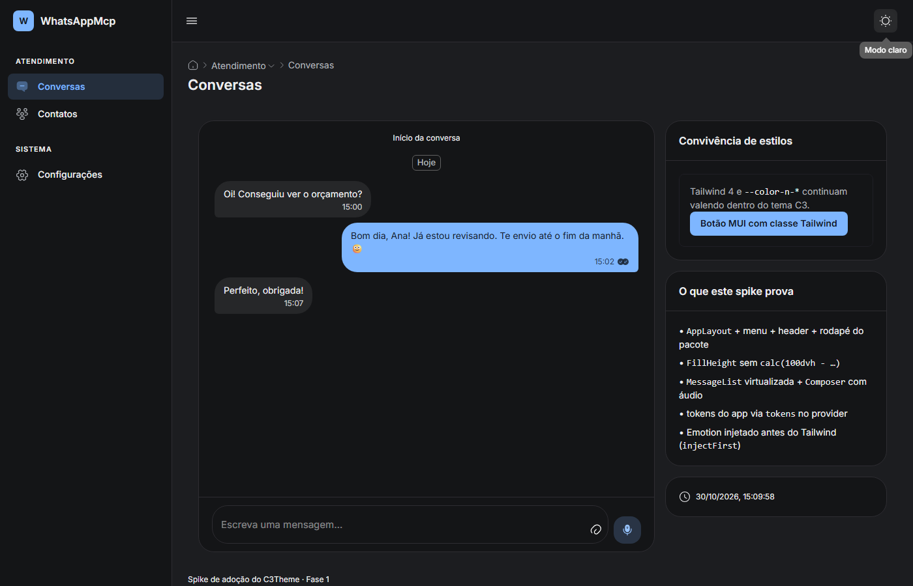

# Fase 2 — fundação do C3Theme no WhatsAppMcp (em andamento)

> **Feito nesta etapa:** decisão de dependência executada (**pnpm**), pacotes do C3Theme fixados por SHA, `C3Provider` (Emotion antes do Tailwind + tokens do app + avisos), ponte de claro/escuro nos dois sentidos e stubs de teste do MUI. **Ainda não**: router, troca do shell (`AppLayout`) e montagem global do provider — isso entra junto com a primeira tela migrada, para o `CssBaseline` do pacote não mexer em telas que ninguém migrou.
>
> Evidências: spike em `?c3spike` sem erro de console, build/lint/testes verdes com `pnpm install --frozen-lockfile`, e o print abaixo (modo escuro trocado pelo botão do C3, com Tailwind e MUI acompanhando).

---

## 1. Decisão executada: pnpm (opção A do [relatório do spike](04-spike-convivencia.md#5-bloqueio-real-da-adoção-o-app-usa-npm-e-o-pacote-é-publicado-por-subpasta))

| Mudança                        | Arquivo                                                                              | Detalhe                                                                                                                                                                                                                                                                              |
| ------------------------------ | ------------------------------------------------------------------------------------ | ------------------------------------------------------------------------------------------------------------------------------------------------------------------------------------------------------------------------------------------------------------------------------------ |
| Gerenciador                    | `package.json`                                                                       | `packageManager: pnpm@10.32.1`; scripts internos passam a chamar `pnpm run`                                                                                                                                                                                                          |
| Dependências novas             | `package.json`                                                                       | `@c3theme/ui` e `@c3theme/chat` em `github:cecon/C3Theme#e88cf03…&path=packages/{ui,chat}` (atualizado em 02/11, ver [41](41-atualizacao-chat-0.3.md)); peers (`@mui/material` 9, `@emotion/*`, `react-intl` 12, `react-router` 8, `iconsax-reactjs`, `stylis`, `stylis-plugin-rtl`) |
| Build scripts                  | `package.json`                                                                       | `pnpm.onlyBuiltDependencies`: `@c3theme/ui`, `@c3theme/chat`, `esbuild`, `sharp` (o pnpm 10 bloqueia `prepare` de pacote git sem allowlist)                                                                                                                                          |
| Lockfile                       | `pnpm-lock.yaml` (novo)                                                              | `package-lock.json` removido; `pnpm install --frozen-lockfile` validado                                                                                                                                                                                                              |
| CI                             | `.github/workflows/ci.yml`                                                           | `pnpm/action-setup@v4`, cache `pnpm`, `pnpm install --frozen-lockfile`, `pnpm run …`, `pnpm audit`                                                                                                                                                                                   |
| Release                        | `.github/workflows/release.yml`                                                      | idem no job Windows; `pnpm run prepare:desktop`, `pnpm exec tauri build`                                                                                                                                                                                                             |
| Autenticação do pacote privado | ambos workflows                                                                      | reescrita de `git@github.com:`, `ssh://git@github.com/` e `https://github.com/` para o token `C3THEME_TOKEN` (o pnpm normaliza `github:` para SSH)                                                                                                                                   |
| Scripts                        | `scripts/version.mjs`, `prepare-desktop.mjs`, `copy-web.mjs`, `playwright.config.ts` | sem `package-lock.json`; build via `pnpm exec`; e2e sobe o dev por `pnpm run dev`                                                                                                                                                                                                    |

**Ação necessária no GitHub:** criar o secret **`C3THEME_TOKEN`** (PAT com _Contents: Read_ no `cecon/C3Theme`). Sem ele, `pnpm install` do CI/release falha ao buscar o pacote privado.

> **No ambiente de dev:** o `node_modules` atual da árvore principal ainda é o do npm (instalado com `--no-save`) porque o dev server do usuário estava rodando. Para migrar: parar o dev server, rodar `pnpm install` e subir de novo com `pnpm run dev`. O worktree de validação `D:\projetos\wamcp-pnpm-check` já está com pnpm e reproduz o resultado.

## 2. Fundação de tema

| Arquivo                          | O que faz                                                                                                                                                                                            |
| -------------------------------- | ---------------------------------------------------------------------------------------------------------------------------------------------------------------------------------------------------- |
| `src/agent/c3/tokens.ts`         | Ponte `agent.css` → `C3Tokens`: primária, fundo, papel, texto, divisórias, cabeçalho e raio (8) por modo claro/escuro, com os mesmos valores dos tokens Tailwind atuais                              |
| `src/agent/c3/C3Provider.tsx`    | `StyledEngineProvider injectFirst` (Emotion antes do Tailwind) + `C3ThemeProvider` (marca `blue`, pt-BR, `storageKey` próprio, `tokens`) + `Notifier`                                                |
| `C3Provider` / `ColorModeBridge` | **um dono só do claro/escuro**: o app escreve `data-theme`, o MUI acompanha; se o usuário troca pelo botão do C3, a escolha volta para o `localStorage` do app — nenhuma tela fica em modo diferente |
| `tests/ui/setup.ts`              | stubs de `matchMedia` e `ResizeObserver` (jsdom não tem; MUI usa) — valem para toda a suíte de UI                                                                                                    |
| `src/agent/c3/spike.tsx`         | passa a consumir o `C3Provider` em vez de montar provider próprio                                                                                                                                    |

**Por que o provider ainda não envolve o `AgentApp`:** `C3ThemeProvider` renderiza `CssBaseline`, que troca tipografia/margens globais. Envolver o app inteiro antes de migrar a primeira tela mudaria visual de telas em Tailwind sem ganho. A montagem global acontece na troca do shell (próxima etapa), quando o `AppLayout` passa a ser a moldura de todas as telas.

## 3. O que foi verificado

| Verificação (worktree limpo, HEAD `d192051`) | Resultado                                                                                                |
| -------------------------------------------- | -------------------------------------------------------------------------------------------------------- |
| `pnpm install --frozen-lockfile`             | “Lockfile is up to date” — lock file consistente                                                         |
| `pnpm run build`                             | verde (`main` 763,8 kB; chunk lazy do C3 559,2 kB)                                                       |
| `pnpm run lint`                              | verde (ESLint + arquitetura + limite de 300 linhas)                                                      |
| `pnpm test`                                  | 6/6                                                                                                      |
| `pnpm run test:ui`                           | verde, cobertura nos limiares 80/80/80/70                                                                |
| Spike `?c3spike` no navegador                | 0 erros de console/página; `AppBar`, `Composer` e balões no DOM; `data-theme` e `data-c3-mode` = `light` |
| Troca de modo pelo botão do C3               | `data-theme` e `data-c3-mode` viram `dark` juntos; `localStorage` do app e do C3 gravam `dark`           |

## 4. Pendências e pedidos pequenos ao C3Theme

1. **Exportar `C3Tokens`/`C3SchemeTokens`** (hoje o tipo não é público; derivei de `C3ThemeProviderProps['tokens']`).
2. **Exportar `useColorMode` e `Z_INDEX`** (existem no pacote, fora do `index.ts`).
3. **`injectFirst` dentro do `C3ThemeProvider`** (hoje cada app precisa lembrar do `StyledEngineProvider`).
4. **Montar a fundação no app** depende de decidir o router (React Router 8 com `basename` que funcione em `/app/` no build e `/` no dev) — próximo passo.

## 5. Próximos passos (continuação da Fase 2)

1. **Router**: `react-router` 8 com rotas derivadas do `route.ts` e `basename` resolvido para dev (`/`) e produção (`/app/`).
2. **Shell**: `AppLayout` com menu de `navItems.ts`/`permissões`, header com busca/notificações/usuário e `FillHeight` nas telas de altura cheia; `C3Provider` montado no `AgentApp`.
3. **Tela piloto**: Configurações → Etiquetas com `DataTable`/campos do pacote; medir a régua de conversão e escrever o script de progresso.
4. **Chat**: `ChatTransport` sobre a API atual e troca de lista/bolha/composer pelo `@c3theme/chat`, mantendo `whatsappFormat` via `renderText`.
